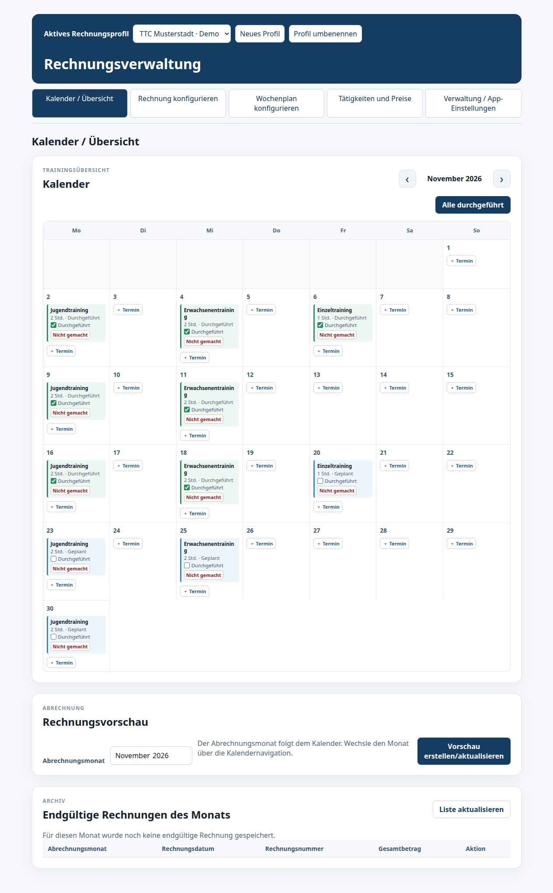
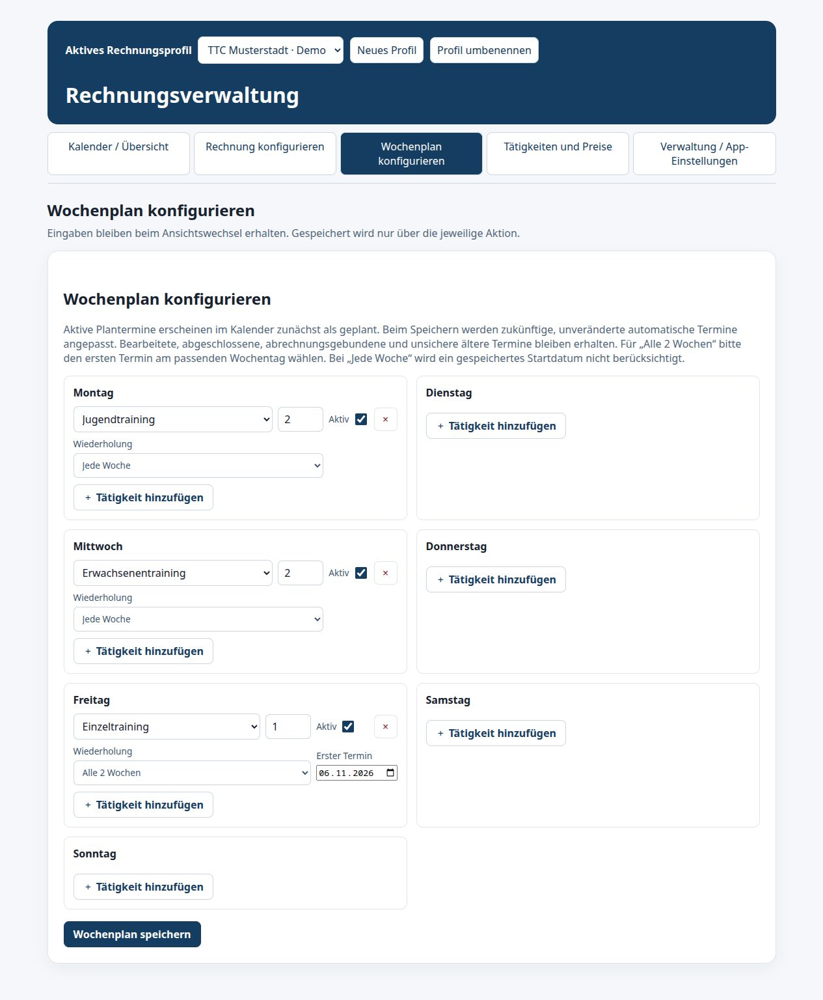
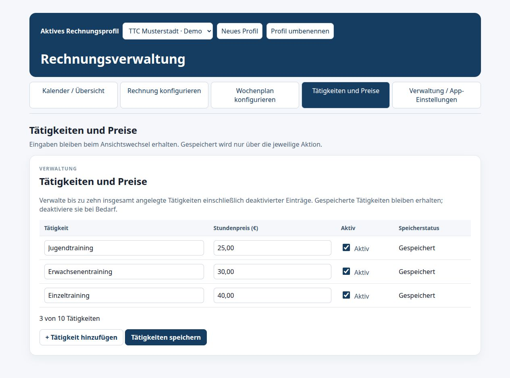

<p align="center">
  
</p>

<h1 align="center">TT Rechnungsverwaltung</h1>

<p align="center">
  <strong>Training planen. Stunden erfassen. Monatsrechnungen erstellen.</strong><br>
  Eine lokale App für die Übungsleitung im Tischtennis – mit Kalender, Wochenplan und PDF-Rechnungen.<br>
  Deine Daten bleiben auf deinem Rechner.
</p>

<p align="center">
  <a href="https://github.com/macfloorball/Rechnungsverwaltung/releases/tag/desktop-v0.2.3"></a>
  
  <a href="LICENSE"></a>
</p>

<p align="center">
  <a href="#download-und-installation"><strong>App herunterladen</strong></a> ·
  <a href="#funktionen">Funktionen</a> ·
  <a href="Planung/Installation.md">Installationsanleitung</a> ·
  <a href="#entwicklung">Entwicklung</a> ·
  <a href="https://github.com/macfloorball/Rechnungsverwaltung/issues">Fehler melden</a>
</p>

<p align="center">
  
  <br>
  <sub>Die aktuelle Oberfläche von Version 0.2.0 im lokalen Webbetrieb. Alle Screenshots zeigen ausschließlich fiktive Demodaten.</sub>
</p>

## Vom Trainingsplan zur Rechnung

| Planen | Abrechnen | Lokal verwalten |
| --- | --- | --- |
| Wiederkehrende Termine im Wochenplan anlegen und im Monatskalender anpassen. | Durchgeführte Trainings prüfen, Monatsvorschau erstellen und die endgültige Rechnung als PDF speichern. | Getrennte Rechnungsprofile, vollständige Sicherungen und CSV-/Dokumentenexport nutzen. |

## Download und Installation

Die fertige Desktop-App benötigt **kein separat installiertes Python, Node.js, npm oder Git**.

| System | Download / Installation |
| --- | --- |
| **Windows x64** | [Setup-EXE im Desktop-Release 0.2.3](https://github.com/macfloorball/Rechnungsverwaltung/releases/tag/desktop-v0.2.3) |
| **Linux x86_64** | [AppImage im Desktop-Release 0.2.3](https://github.com/macfloorball/Rechnungsverwaltung/releases/tag/desktop-v0.2.3) |
| **Fedora 45 x86_64** | [Signiertes DNF-Repository](https://macfloorball.github.io/Rechnungsverwaltung/rpm/) |

Download, Installation, Start und Updates sind in der **[deutschsprachigen Installationsanleitung](Planung/Installation.md)** beschrieben.
Der Windows-Installer besitzt derzeit keine Authenticode-Signatur; Windows kann deshalb Warnungen anzeigen.

> [!IMPORTANT]
> **Vor einem Update eine vollständige App-Sicherung erstellen.** Version 0.2.0 migriert die Datenbank; bestehende Daten werden dem Standardprofil TTC zugeordnet. Für eine Rückkehr zu einer älteren Version ist eine passende Sicherung erforderlich. Bei Windows 0.1.0/0.1.1 ist einmalig ein vollständiges Setup ab 0.1.2 nötig. Details stehen in der Installationsanleitung.

## Funktionen

### Den Monat im Blick behalten

Im Kalender erfasst und bearbeitest du Termine, wechselst zwischen Monaten und markierst Trainings als durchgeführt oder ausgefallen. Eine Sammelaktion schließt die geplanten Termine eines Monats ab.

Die Rechnungsvorschau direkt unter dem Kalender verwendet die durchgeführten, abrechenbaren Termine des ausgewählten Monats. Endgültige Rechnungen werden mit ihren Positionen und Einstellungen gespeichert; ihre PDFs bleiben bei späteren Änderungen erhalten.

### Wiederkehrende Trainings einmal planen

Lege für jeden Wochentag Tätigkeiten und Stunden fest. Jeder Eintrag kann **wöchentlich oder alle zwei Wochen** wiederholt werden. Beim 14-tägigen Rhythmus wählst du ausdrücklich den ersten Termin.



Änderungen am Wochenplan passen zukünftige, unveränderte automatische Termine an. Bearbeitete, abgeschlossene und bereits abrechnungsgebundene Termine bleiben geschützt. Die [technische Beschreibung der Wiederholungsregeln](Planung/Technische_Dokumentation.md#wiederholung-je-wochenplaneintrag) erläutert die Details.

### Eigene Tätigkeiten und Preise verwenden

Pro Rechnungsprofil sind bis zu **zehn Tätigkeiten** mit eigenen Stundenpreisen möglich. Nicht mehr benötigte Tätigkeiten lassen sich deaktivieren und bleiben für bestehende Daten erhalten.



### Rechnungen passend zum Auftraggeber erstellen

- **Getrennte Rechnungsprofile** für verschiedene Vereine und Auftraggeber, mit bestätigtem Löschen einschließlich Datenübersicht.
- Eigene Absender-, Empfänger-, Steuer- und Zahlungsangaben sowie ein optionales Logo.
- Jährliche Rechnungsnummern 01–12 je Profil, automatisch oder manuell mit optionalem Präfix.
- Lückenprüfung und ausdrückliche Nummernkorrektur mit neuem PDF aus den gespeicherten Rechnungsangaben.
- Gespeicherte Monatsrechnungen als PDF öffnen und herunterladen.

### Daten sichern und mitnehmen

Unter **Verwaltung / App-Einstellungen** erstellst du vollständige Sicherungen und exportierst Daten als CSV sowie gespeicherte Dokumente. Eine vollständige Sicherung umfasst alle Profile, die Datenbank, Einstellungen und PDFs. Die Wiederherstellung erfolgt bei beendeter App gemäß [Anleitung](Planung/Installation.md).

Änderungen an Formularen bleiben beim Wechsel der Ansicht erhalten. Dauerhaft gespeichert werden sie über den jeweiligen Speichern-Button.

## Entwicklung

Die App verbindet **Electron**, ein **FastAPI-Backend**, **SQLite** und **ReportLab** mit einer Oberfläche aus HTML, CSS und JavaScript. Das Frontend wird lokal vom Backend ausgeliefert.

Für den Start aus dem Quellcode werden Python ab 3.10 und die Python-Abhängigkeiten benötigt. Für die Desktop-Entwicklung zusätzlich Node.js ab 22.12.0 und npm.

```bash
git clone https://github.com/macfloorball/Rechnungsverwaltung.git
cd Rechnungsverwaltung
python3 -m venv .venv
source .venv/bin/activate
python -m pip install -r requirements.txt
python -m uvicorn backend.main:app --host 127.0.0.1 --port 8000
```

Unter Windows aktivierst du die Umgebung mit `.venv\Scripts\activate`. Die Weboberfläche erreichst du anschließend unter **http://127.0.0.1:8000**.

Für die Desktop-Entwicklung mit aktivierter Python-Umgebung:

```bash
npm ci
npm run desktop:dev
```

Prüfungen:

```bash
python -m pytest
npm run desktop:check
```

Weitere Startmodi, Pfadkonfiguration, Architektur, Datenbankmigrationen, PDF-Abläufe und Releaseprozesse stehen in der [ausführlichen technischen Dokumentation](Planung/Technische_Dokumentation.md). Die bisherigen technischen README-Inhalte bleiben dort erhalten.

## Dokumentation und Hilfe

| Thema | Dokument |
| --- | --- |
| Installation, Updates und Fehlerhilfe | [Installationsanleitung](Planung/Installation.md) |
| Entwicklung und technische Hintergründe | [Technische Dokumentation](Planung/Technische_Dokumentation.md) |
| Lokale Veröffentlichung | [Release-Anleitung](RELEASE_ANLEITUNG_LOKAL.md) |
| Fremdkomponenten und Lizenzhinweise | [Third-Party Notices](THIRD_PARTY_NOTICES.md) |
| Fehler und Verbesserungsvorschläge | [GitHub Issues](https://github.com/macfloorball/Rechnungsverwaltung/issues) |

## Datenschutz und lokaler Betrieb

Die Anwendung ist für den lokalen Betrieb gedacht und besitzt keine Benutzerkonten oder Anmeldung. Den Webserver nur an die lokale Loopback-Adresse binden und nicht ungeschützt im Netzwerk oder Internet bereitstellen. Datenbank, Rechnungen und Sicherungen können personenbezogene und finanzielle Angaben enthalten und gehören nicht ins Repository.

## Lizenz

Der eigene Projektcode steht unter der **[MIT-Lizenz](LICENSE)**. Fremdkomponenten behalten ihre jeweiligen Lizenzen; die Hinweise dazu stehen in [THIRD_PARTY_NOTICES.md](THIRD_PARTY_NOTICES.md).
